<a href="https://miaaa3.github.io">
  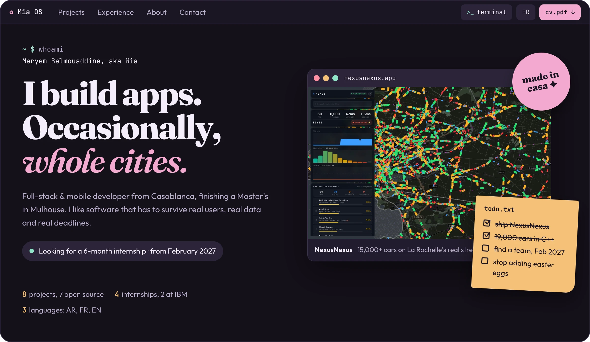
</a>

<p align="center">
  <a href="https://miaaa3.github.io">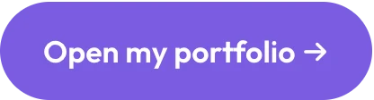</a>
  <a href="https://miaaa3.github.io/assets/CV-Meryem-Belmouaddine.pdf">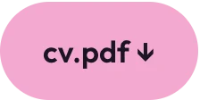</a>
  <a href="https://www.linkedin.com/in/meryem-belmouaddine">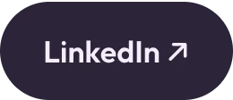</a>
</p>

<p align="center">
  
</p>

## `~/projects` · 8 items

Each card opens its case study: the problem, the plot twists, the actual solution, the bugs, and what I'd do next.

<p align="center">
  <a href="https://miaaa3.github.io/work/nexusnexus/">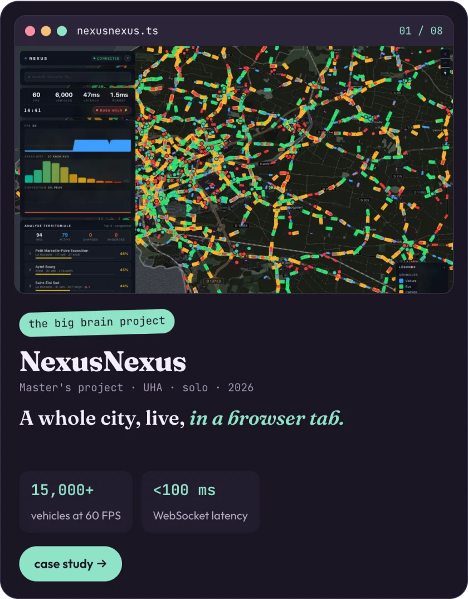</a>
  <a href="https://miaaa3.github.io/work/v2v-simulator/">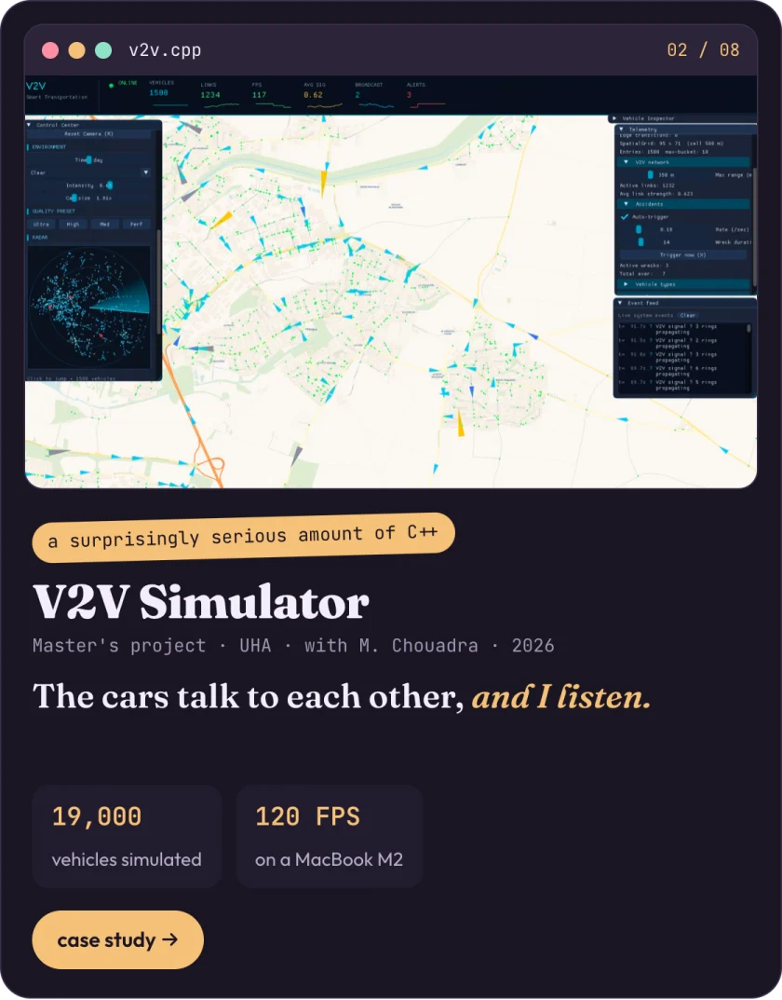</a>
</p>
<p align="center">
  <a href="https://miaaa3.github.io/work/lingobingo/">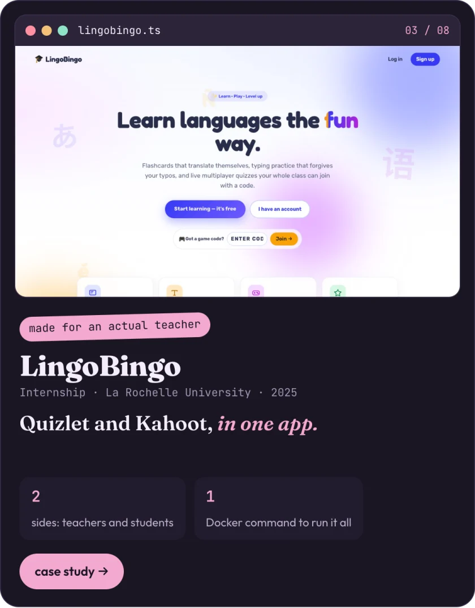</a>
  <a href="https://miaaa3.github.io/work/bloom/">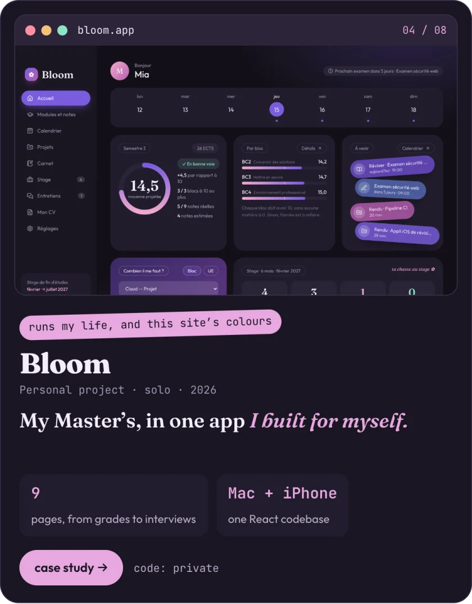</a>
</p>
<p align="center">
  <a href="https://miaaa3.github.io/work/helpinghands/">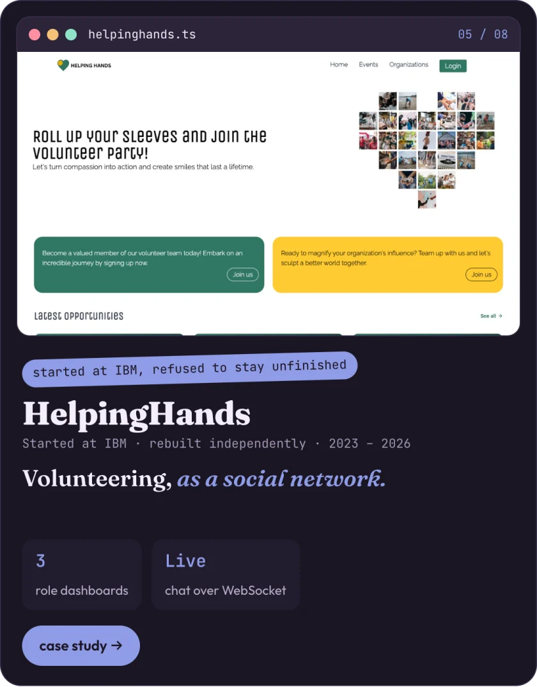</a>
  <a href="https://miaaa3.github.io/work/klosnowo/">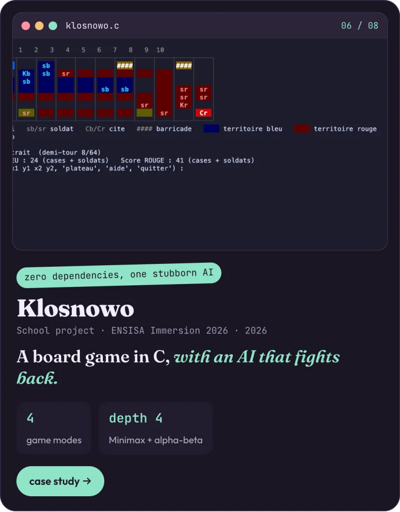</a>
</p>
<p align="center">
  <a href="https://miaaa3.github.io/work/lbp-parking-classifier/">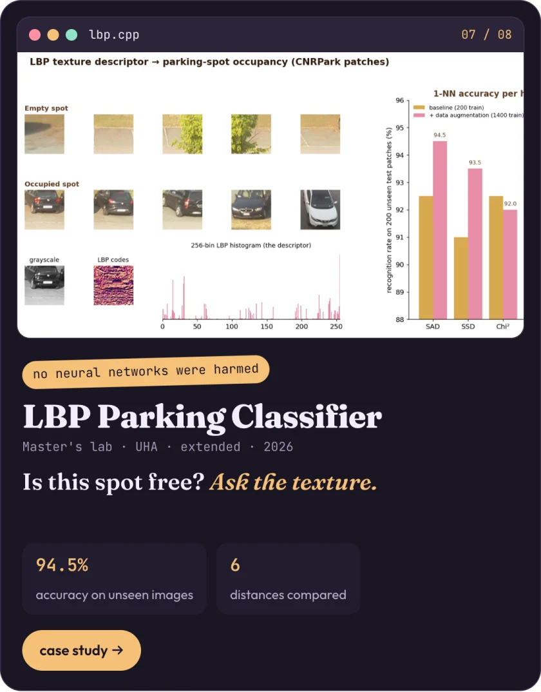</a>
  <a href="https://miaaa3.github.io/work/togetherly/">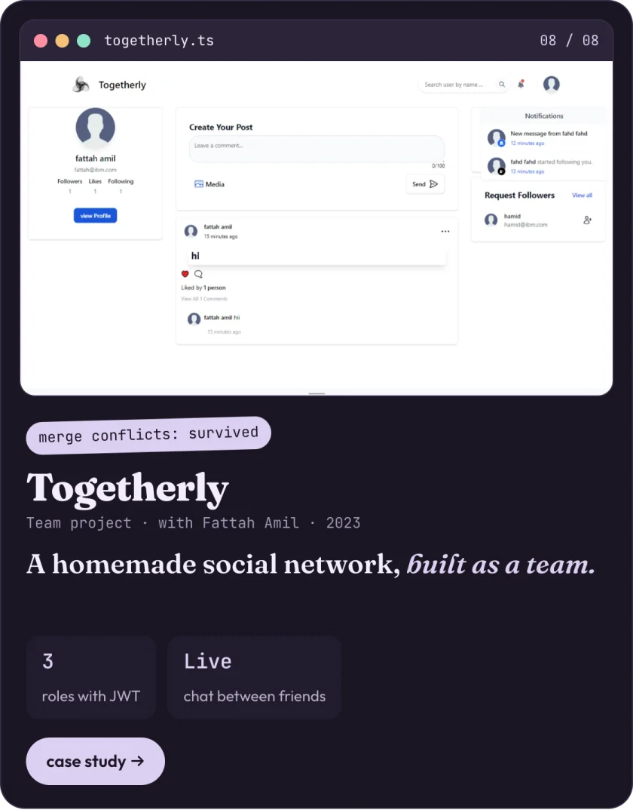</a>
</p>

<br/>

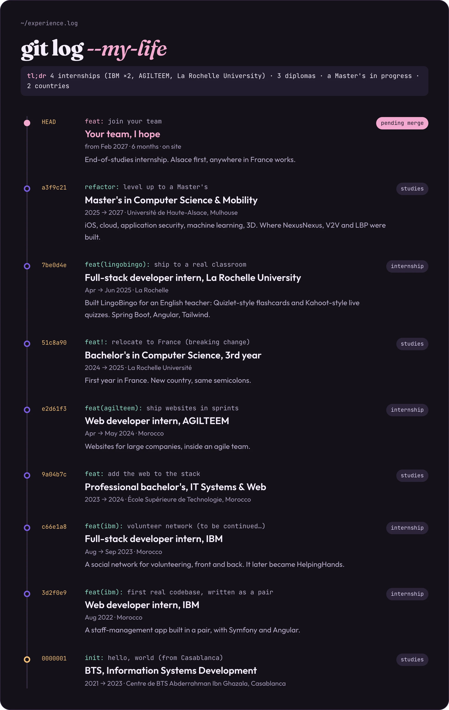

## `~/skills.json`

```json
{
  "every_day": ["Java", "TypeScript", "Angular", "Spring Boot", "REST", "MySQL", "Git", "Docker"],
  "in_projects": ["C++", "C", "OpenGL", "WebGL2", "MapLibre", "OpenCV", "Swift", "SwiftUI", "Python", "Electron", "React", "Symfony"],
  "ops": ["GitHub Actions", "Linux", "Maven", "CMake", "nginx"],
  "languages": { "arabic": "native", "french": "fluent", "english": "advanced" },
  "coffee": "Infinity"
}
```

## `~/streak`

<p align="center">
  
</p>

<p align="center">
  <picture>
    <source media="(prefers-color-scheme: dark)" srcset="https://raw.githubusercontent.com/miaaa3/miaaa3/output/snake-dark.svg" />
    
  </picture>
</p>

<p align="center"><sub>psst: on the portfolio, press <code>`</code> for the real terminal, and click the coffee when it runs out.</sub></p>

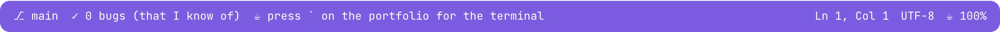
