<p align="center">
  
</p>

<p align="center">
  <a href="https://miaaa3.github.io"></a>
  <a href="https://www.linkedin.com/in/meryem-belmouaddine"></a>
  
  
  
</p>

<p align="center">
  
</p>

## 🌸 `const meryem = ...`

```ts
const meryem = {
  role: "Développeuse full-stack & mobile",
  ecole: "M2 Informatique et Mobilité @ Université de Haute-Alsace",
  experiences: ["IBM ×2", "AGILTEEM", "Université de La Rochelle"],
  superPouvoirs: ["Angular", "Spring Boot", "Swift", "WebGL", "transformer le café en code"],
  enCeMoment: "je fais rouler 15 000 voitures dans un navigateur sans qu'il prenne feu 🚗🔥",
  cherche: {
    quoi: "un stage de fin d'études",
    duree: "6 mois",
    debut: "février 2027",
    ou: "Alsace 💜 (ou partout en France, j'ai une valise)",
  },
  bugPrefere: "celui qui disparaît dès que quelqu'un regarde mon écran",
};
```

<p align="center">
  
</p>

## 🧰 Mon inventaire

<p align="center">
  <br/>
  <br/>
  
</p>

## 🗺️ Mon multivers de projets

<table>
  <tr>
    <td width="50%" valign="top">
      <h3>🚦 <a href="https://github.com/miaaa3/nexusnexus">NexusNexus</a></h3>
      <sub>« et si une ville entière tenait dans un onglet ? »</sub><br/><br/>
      Trafic de smart city en temps réel : <b>15 000+ véhicules</b> en WebGL2, poussés par WebSocket en <b>moins de 100 ms</b>, routés en A* sur les vraies routes OpenStreetMap, avec les données INSEE par quartier.<br/><br/>
      <code>Angular</code> <code>WebGL2</code> <code>Spring Boot</code> <code>WebSocket</code>
    </td>
    <td width="50%" valign="top">
      <h3>🚗 <a href="https://github.com/miaaa3/v2v">V2V Simulator</a></h3>
      <sub>« les voitures se parlent, et je les écoute »</sub><br/><br/>
      Simulateur temps réel de communication véhicule-à-véhicule : <b>2 000+ véhicules à 60 FPS</b> sur un réseau OpenStreetMap, avec un graphe de communication qui bouge en direct.<br/><br/>
      <code>C++</code> <code>OpenGL</code> <code>OpenStreetMap</code>
    </td>
  </tr>
  <tr>
    <td width="50%" valign="top">
      <h3>🎓 <a href="https://github.com/miaaa3/LingoBingo">LingoBingo</a></h3>
      <sub>« apprendre, mais en mode jeu vidéo »</sub><br/><br/>
      Plateforme d'apprentissage gamifiée : les profs créent cours, flashcards et quiz notés, les étudiants apprennent, s'entraînent et s'affrontent. Tout se lance en une commande Docker.<br/><br/>
      <code>Angular</code> <code>Spring Boot</code> <code>MySQL</code> <code>Docker</code>
    </td>
    <td width="50%" valign="top">
      <h3>🤝 <a href="https://github.com/miaaa3/HelpingHands">HelpingHands</a></h3>
      <sub>« le bénévolat, version appli »</sub><br/><br/>
      Bénévoles et associations se trouvent, postulent, discutent, font des dons et suivent leur impact depuis des tableaux de bord par rôle.<br/><br/>
      <code>Angular</code> <code>Spring Boot</code> <code>TypeScript</code>
    </td>
  </tr>
  <tr>
    <td width="50%" valign="top">
      <h3>💬 <a href="https://github.com/miaaa3/Togetherly-Angular-Spring-Boot">Togetherly</a></h3>
      <sub>« un réseau social fait maison »</sub><br/><br/>
      Auth JWT, rôles, posts, likes, commentaires, abonnements, notifications et chat temps réel en WebSocket.<br/><br/>
      <code>Angular</code> <code>Spring Boot</code> <code>JWT</code> <code>WebSocket</code>
    </td>
    <td width="50%" valign="top">
      <h3>✿ Bloom</h3>
      <sub>« une appli pour savoir si je valide mon année (spoiler : oui) »</sub><br/><br/>
      Mon QG de M2 sur Mac : notes et validation par bloc, calendrier synchronisé, révisions planifiées le soir, suivi des candidatures et CV LaTeX adapté à chaque offre.<br/><br/>
      <code>Electron</code> <code>React</code> <code>LaTeX</code>
    </td>
  </tr>
</table>

<details>
  <summary><b>🤫 Clique ici pour 3 fun facts</b></summary>
  <br/>

  1. J'ai codé une appli pour planifier mes révisions… et j'ai passé plus de temps sur l'appli que sur les révisions.
  2. Je nomme mes projets avant d'écrire la première ligne de code. Les priorités. ✿
  3. Mes simulations font rouler des milliers de voitures, mais moi je prends le tram.
</details>

## 📈 Ma série

<p align="center">
  
</p>

<p align="center">
  <picture>
    <source media="(prefers-color-scheme: dark)" srcset="https://raw.githubusercontent.com/miaaa3/miaaa3/output/snake-dark.svg" />
    
  </picture>
  <br/><sub>🐍 ce serpent mange mes commits. je code plus vite pour qu'il ait moins faim.</sub>
</p>

<p align="center">
  
</p>
